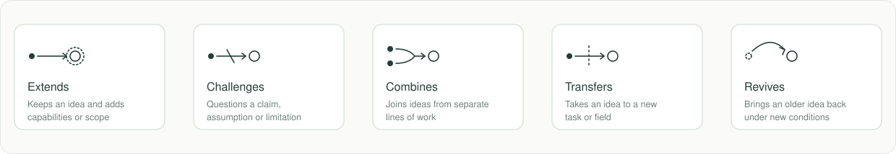
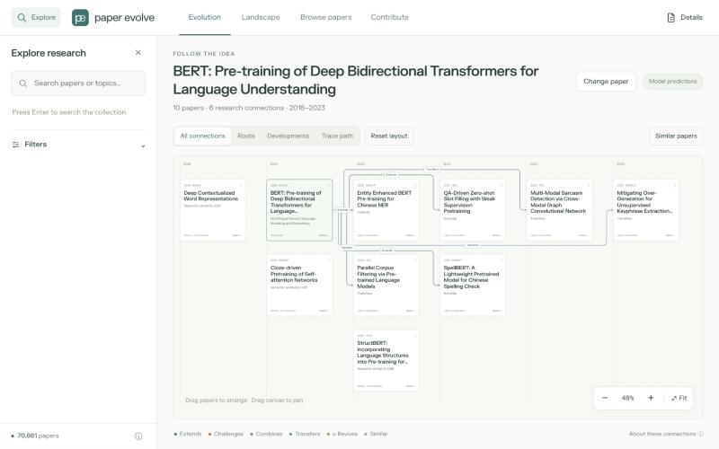
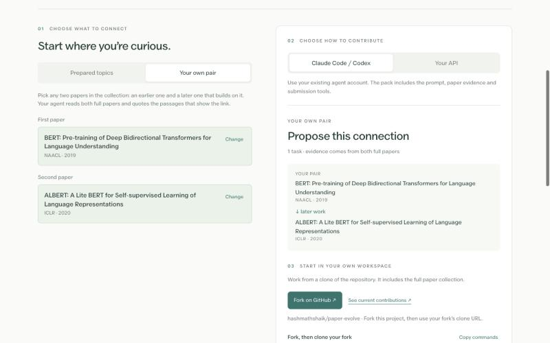

<p align="center">
  <a href="https://hashmathshaik.github.io/paper-evolve/">
    
  </a>
</p>

<h1 align="center">Paper Evolve</h1>

<p align="center">
  <b>Follow how research ideas build on each other.</b><br>
  70,861 AI papers, connected by what each one took from earlier work and what it changed.
</p>

<p align="center">
  <a href="https://hashmathshaik.github.io/paper-evolve/"><b>Open the live site</b></a> ·
  <a href="https://hashmathshaik.github.io/paper-evolve/contribute.html">Add a connection</a> ·
  <a href="community/PAPERS.md">Add papers</a> ·
  <a href="CONTRIBUTING.md">Contributor guide</a>
</p>

<p align="center">
  <a href="https://github.com/hashmathshaik/paper-evolve/actions/workflows/pages.yml"></a>
  
  
  <a href="LICENSE"></a>
</p>

## What you can do with it

Pick any paper and see the earlier work it grew from and the later work that
grew from it. Every connection says which kind it is, what was kept and what
changed, and shows the passages from both papers that support it.

<p align="center">
  
</p>

<table>
  <tr>
    <td width="50%"><a href="https://hashmathshaik.github.io/paper-evolve/"></a></td>
    <td width="50%"><a href="https://hashmathshaik.github.io/paper-evolve/contribute.html"></a></td>
  </tr>
  <tr>
    <td align="center"><b>Evolution</b>: one paper, the work before it and after it</td>
    <td align="center"><b>Contribute</b>: pick two papers and propose how they connect</td>
  </tr>
</table>

### How the field has shifted

The Landscape view shows each research area's share of the year's papers. This
is drawn from the collection itself:

<p align="center">
  <a href="https://hashmathshaik.github.io/paper-evolve/#landscape"></a>
</p>

## Add a connection

The graph grows through pull requests. Your agent does the reading; you never
need an API key unless you choose that route.

<p align="center">
  
</p>

Fork this repository, clone your fork, then run one command.

**A prepared task pack**, reviewed by Claude Code or Codex:

```sh
python paper_evolve.py list
python paper_evolve.py run --pack PACK_ID --name "Your name" --agent claude
```

**Any two papers you choose:**

```sh
python paper_evolve.py find "words from a title"
python paper_evolve.py run --earlier "Earlier paper" --later "Later paper" --name "Your name"
```

`run` prepares a workspace, has your agent read both papers and quote the
passages that show the link, validates every quote against its source, and
prints the Git commands for your pull request. It never commits or pushes.

| You have | Use | Key needed |
|---|---|---|
| Claude Code or Codex | `run --agent claude` or `run --agent codex` | None |
| An API account (OpenAI, OpenRouter, Qwen, …) | `start --method api`, then `api` | Your provider's usual one, such as `OPENAI_API_KEY` |
| Neither, or you prefer to read yourself | `start`, fill in `submission.json`, `check`, `pr` | None |

The [contribution page](https://hashmathshaik.github.io/paper-evolve/contribute.html)
builds these commands for you and offers small downloadable kits. Details:
[clone guide](community/CLONE.md) · [API guide](community/API.md) ·
[full-paper research](community/RESEARCH.md).

There are 46 topic packs with 10 source-ready tasks each, and every other pair
in the collection is open to propose. Finding that two papers are unrelated is
a welcome contribution too.

## Add papers or a whole conference

The collection itself is open. Register a venue once, then add its papers:

```sh
python paper_evolve.py add-venue --id cvpr --name CVPR --host openaccess.thecvf.com
python paper_evolve.py add-papers --file my-papers.json --name "Your name" --tool "Your agent / model"
```

New papers appear with their nearest published papers by wording and, when
enough of those agree, a topic. See [the papers guide](community/PAPERS.md),
which includes a ready prompt for your agent.

## What makes a connection count

- It names one of the five types, with what was **inherited** and what **changed**.
- It quotes **both** papers, including the passage where the later one cites the earlier one.
- Every quote must match its source exactly; the `check` command and pull-request CI enforce this.
- A maintainer reads the sources before accepting. Accepted connections carry the contributor's name.

The site always says where a connection came from: predicted by a model,
checked by an AI assistant, or reviewed by a person.

## Run it locally

```sh
python build_evolve.py
python -m http.server 8765 --directory dist
```

Open `http://localhost:8765/`. The build uses only files in this repository, calls
no model and needs no API keys.

<details>
<summary><b>Repository map</b></summary>

| Path | What it holds |
|---|---|
| `index.html`, `contribute.html`, `evolve/` | The static site: pages, scripts, styles and the published data (`evolve/corpus.json`, `evolve/generated/`). |
| `community/` | Everything contributors touch: task packs, submissions, accepted reviews, paper additions, the venue registry and the guides. |
| `paper_evolve.py`, `scripts/` | The contributor tool, its validators and the shared modules they and the site build import. Standard library only. |
| `scripts/pipeline/` | Maintainer preparation jobs: abstracts, embeddings, citation data and model-reviewed connections. They need the private `work/` caches. |
| `build_evolve.py`, `scripts/ui_assets.py` | Packages the site into `dist/`; run by the Pages workflow. |
| `tests/` | Unit tests for the tools, validators and front-end logic. |
| `paper_atlas/`, `config/`, `remote_jobs/` | The ingestion adapters, per-venue settings and GPU jobs that built the original collection and its topics. |
| `docs/` | Decision logs, reproduction notes, review notes and figures. |
| `legacy/` | The earlier single-page Paper Atlas and its builders, kept for reference. |

</details>

<details>
<summary><b>Publishing and development</b></summary>

The site deploys from `main` through the GitHub Actions Pages workflow, which
tests, validates, builds and publishes `dist/`. It supplies the repository
identity for the Fork and pull-request links. Custom hosting can set
`community/project.json` to `{"repository":"OWNER/REPO"}` or use
`PAPER_EVOLVE_REPOSITORY=OWNER/REPO` at build time.

Before proposing code changes, run `python -m unittest discover -s tests` and
`python scripts/community_edges.py check`. [EVOLVE.md](EVOLVE.md) describes the
app and preparation pipeline, and the [decision logs](docs/decisions/) explain
the model, evidence and architecture choices.

</details>

## License

Code is [MIT licensed](LICENSE); retain its copyright notices. Bundled fonts
have SIL Open Font Licenses in `fonts/`, and bundled libraries retain their
licenses. Paper metadata and source excerpts remain attributable to their
original authors and publishers.
